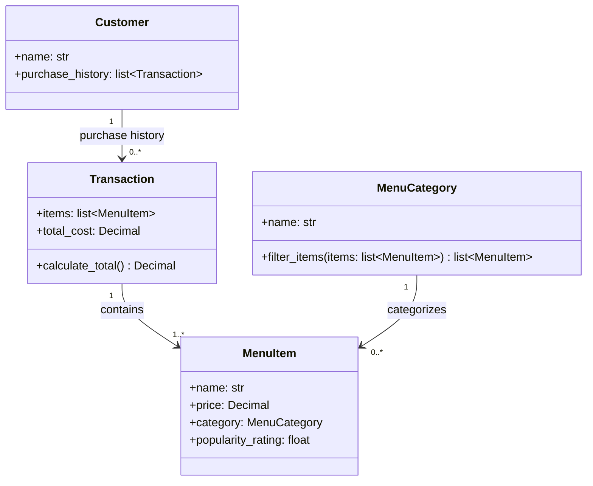

<!-- Suggestions and change details: aligned the diagram with the four classes and feature descriptions, removed unsupported identifiers and transaction details, corrected class references, and included category filtering. -->